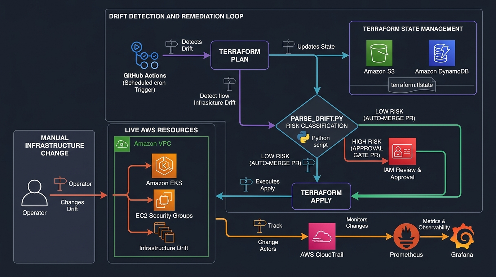

# Terraform Drift Detection & Auto-Remediation Loop (AWS)

A production-grade continuous control loop for detecting Terraform drift in AWS infrastructure and automatically remediating it via GitHub Pull Requests, with a tiered approval gate and Grafana observability dashboard.

---

## Architecture



### Architecture Flow & Lifecycle

| Stage | Process / Component | Security & Permission Boundary | Function & Decision Logic |
| :--- | :--- | :--- | :--- |
| **1. Drift Origin** | Operator / Console Mutation | Live AWS Resources | Out-of-band manual modification in AWS Console or CLI creates divergence from state. |
| **2. Detection Cron** | Scheduled Trigger (every 1h) | Concurrency Group: `drift-detection` | GitHub Actions cron runs with least-privilege `drift-detection-role` to run `terraform plan -detailed-exitcode`. |
| **3. State Lock & Diff** | Remote State Backend | **Amazon S3** + **Amazon DynamoDB** | Terraform downloads state from S3 and locks state with DynamoDB. |
| **4. Risk Engine** | `parse_drift.py` | Sanitized Diff Engine | Parses changes, assigns a unique `cycle_id`, redacts sensitive values, and enforces safety rules: blocks deletions/replacements and marks unknown resources as `HIGH_RISK`. |
| **5A. Low-Risk Gate** | Automated Remediation | `auto-merge-low-risk` | Tag/metadata drift on known resources triggers automated PR with auto-merge enabled. |
| **5B. High-Risk Gate** | Human Approval Gate | Explicit Reviewers + Labels | Critical infrastructure, destructive actions, or unknown resources trigger `requires-approval` PR and require human approval. |
| **6. Remediation** | Terraform Apply Execution | `drift-remediation-role` | Post-merge apply assumes the dedicated remediation role to reconcile live AWS infrastructure back to state. |
| **7. Audit & Actors** | Change Actor Correlation | **AWS CloudTrail** | CloudTrail lookup correlates actual AWS physical IDs (e.g., `subnet-xxx`, `sg-xxx`) with a 6-hour lookback window, filtering out internal CI roles. |
| **8. Observability** | Metrics & Telemetry | **Prometheus** + **Grafana** | `metrics_exporter.py` surfaces drift metrics, cycle tracking, and resolution times to Grafana. |

---

## Project Structure

```
drift-detection/
├── docs/                       # Architecture diagrams & visual assets
│   └── architecture-diagram.jpg
├── terraform/                  # Phase 1 — Baseline Terraform infra
│   ├── backend.tf              # S3 + DynamoDB remote backend
│   ├── main.tf                 # Root module (composes all child modules)
│   ├── variables.tf
│   ├── outputs.tf              # Exports detection and remediation role ARNs
│   └── modules/
│       ├── vpc/                # VPC, subnets, IGW, NAT GW, route tables
│       ├── security_groups/    # EKS cluster + node SGs
│       ├── iam/                # Separated least-privilege detection & remediation roles
│       └── eks/                # EKS cluster + managed node group
│
├── .github/workflows/
│   ├── drift-detection.yml     # Scheduled detection cron with cycle IDs & sanitized evidence
│   └── drift-remediation-apply.yml  # Post-approval apply & auto-merge triggers
│
├── scripts/
│   ├── parse_drift.py          # Plan parser, sanitization, destructive check & cycle IDs
│   ├── create_pr.py            # PR creation with duplicate detection & reviewer routing
│   ├── log_drift_event.py      # Event logging with real physical ID CloudTrail correlation
│   └── e2e_test.py             # Complete test suite with 4 simulation test cases
│
├── monitoring/
│   ├── metrics_exporter.py     # Prometheus metrics endpoint
│   ├── prometheus.yml          # Scrape config
│   ├── grafana-dashboard.json  # 10-panel Grafana dashboard
│   ├── Dockerfile.exporter
│   └── grafana-provisioning/
│       └── datasources/prometheus.yml
│
├── docker-compose.yml          # Local monitoring stack
├── requirements.txt
└── .gitignore
```

---

## Security Architecture & Core Improvements

### 1. Separated IAM Detection and Remediation Roles
Instead of a single broad CI role, permissions are divided according to the Principle of Least Privilege:
- **`drift-detection-role`**: Read-only infrastructure access (`ec2:Describe*`, `eks:Describe*`, `iam:Get/List`), state lock/read permissions, and `cloudtrail:LookupEvents`. Cannot modify or destroy live infrastructure.
- **`drift-remediation-role`**: Write permissions required for `terraform apply`. Only assumed post-merge after approval gates pass.

### 2. Fixed Workflow Triggers & Concurrency
- `drift-remediation-apply.yml` triggers on both `pull_request: types: [opened, closed]`:
  - `opened`: Evaluates whether the PR is eligible for auto-merge.
  - `closed`: Executes `terraform apply` only when merged.
- Concurrency locks (`drift-detection` and `terraform-apply`) prevent overlapping executions and state lock race conditions.

### 3. Destruction & Replacement Protection
Any plan action containing `delete` or replacement (`["create", "delete"]` or `["delete", "create"]`) is strictly classified as `HIGH_RISK`. Auto-apply is unconditionally disabled and a prominent destructive warning alert is added to the PR.

### 4. Unknown Resource Handling
Any resource type that is undefined, unparsed, or not part of the verified low-risk catalog is classified as `HIGH_RISK` and routed for human approval.

### 5. Sensitive Plan Sanitization
- Attributes identified by Terraform's `before_sensitive` / `after_sensitive` maps or matching sensitive keywords (`password`, `secret`, `token`, `key`, `cert`, `credential`) are automatically masked with `***SENSITIVE***`.
- Raw `plan.json` and credentials are never committed to the git branch; only sanitized summaries are stored.

### 6. Drift-Cycle IDs & Duplicate Prevention
- Every execution receives a traceable cycle ID (e.g. `drift-cycle-20261025-010300-a1b2c3`).
- If an active drift PR is already open, the pipeline comments on the existing PR with cycle updates rather than spamming duplicate PRs.

### 7. Enhanced CloudTrail Correlation
- Queries CloudTrail using real AWS physical IDs (`subnet-xxx`, `sg-xxx`, `arn:aws:...`) extracted from state rather than module address basenames.
- Uses a configurable 6-hour lookback window matching the cron interval.
- Automatically excludes internal CI/CD assumed roles to isolate human out-of-band modifications.

---

## Quick Start

### Prerequisites
- Terraform >= 1.5.0
- AWS CLI configured with appropriate permissions
- Python 3.10+
- Docker + Docker Compose (for monitoring stack)

### Step 1 — Bootstrap the backend (first time only)

```bash
aws s3 mb s3://drift-detection-tfstate-bucket --region us-east-1
aws dynamodb create-table \
  --table-name terraform-state-lock \
  --attribute-definitions AttributeName=LockID,AttributeType=S \
  --key-schema AttributeName=LockID,KeyType=HASH \
  --billing-mode PAY_PER_REQUEST \
  --region us-east-1
```

### Step 2 — Deploy baseline infrastructure

```bash
cd terraform
terraform init
terraform plan
terraform apply
```

### Step 3 — Configure GitHub Actions secrets

In repository **Settings → Secrets and variables → Actions**:

| Secret | Description |
|---|---|
| `AWS_DRIFT_DETECTION_ROLE_ARN` | Output from `terraform output drift_detection_role_arn` (least-privilege read role) |
| `AWS_DRIFT_REMEDIATION_ROLE_ARN` | Output from `terraform output drift_remediation_role_arn` (apply role) |
| `TF_STATE_BUCKET` | `drift-detection-tfstate-bucket` |
| `TF_LOCK_TABLE` | `terraform-state-lock` |
| `DRIFT_GITHUB_TOKEN` | GitHub PAT or App token with `repo` scope (allows auto-merge to trigger CI) |
| `DRIFT_PR_REVIEWERS` | Comma-separated GitHub usernames for mandatory high-risk reviews |

### Step 4 — Run End-to-End Simulation Tests

Run the complete pipeline demonstration locally without needing live AWS credentials:

```bash
python scripts/e2e_test.py --simulate
```

This verifies:
1. **Low-Risk Case**: Metadata tag change $\rightarrow$ `LOW_RISK` $\rightarrow$ auto-merge enabled.
2. **High-Risk Case**: Security Group rule modification $\rightarrow$ `HIGH_RISK` $\rightarrow$ human approval required.
3. **Destructive Case**: Subnet deletion action $\rightarrow$ `HIGH_RISK` $\rightarrow$ destructive alert triggered.
4. **Unknown Case**: Custom database with sensitive password $\rightarrow$ `HIGH_RISK` $\rightarrow$ password redacted.

### Step 5 — Start Monitoring Stack

```bash
docker-compose up -d
```
- **Grafana**: http://localhost:3000 (admin / driftdetection)
- **Prometheus**: http://localhost:9090
- **Metrics endpoint**: http://localhost:8000/metrics

---

## Risk Classification Policy

| Change Pattern / Resource | Actions | Risk Tier | Auto-Apply | Remediation Route |
|---|---|---|---|---|
| Tags, labels, metadata on managed resource | `update` | `LOW_RISK` | ✅ Yes | Auto-Merge PR $\rightarrow$ Auto Apply |
| `aws_security_group`, `aws_security_group_rule` | Any | `HIGH_RISK` | ❌ No | Human Approval Gate |
| `aws_vpc`, `aws_subnet`, `aws_route_table` | Any | `HIGH_RISK` | ❌ No | Human Approval Gate |
| `aws_iam_role`, `aws_iam_policy` | Any | `HIGH_RISK` | ❌ No | Human Approval Gate |
| `aws_eks_cluster`, `aws_eks_node_group` | Any | `HIGH_RISK` | ❌ No | Human Approval Gate |
| Any resource deletion or replacement | `delete` | `HIGH_RISK` | ❌ No | Human Approval Gate (Destructive Alert) |
| Unknown / unregistered resource type | Any | `HIGH_RISK` | ❌ No | Human Approval Gate |
| Any sensitive attribute modification | Any | `HIGH_RISK` | ❌ No | Masked & Human Approval Gate |
