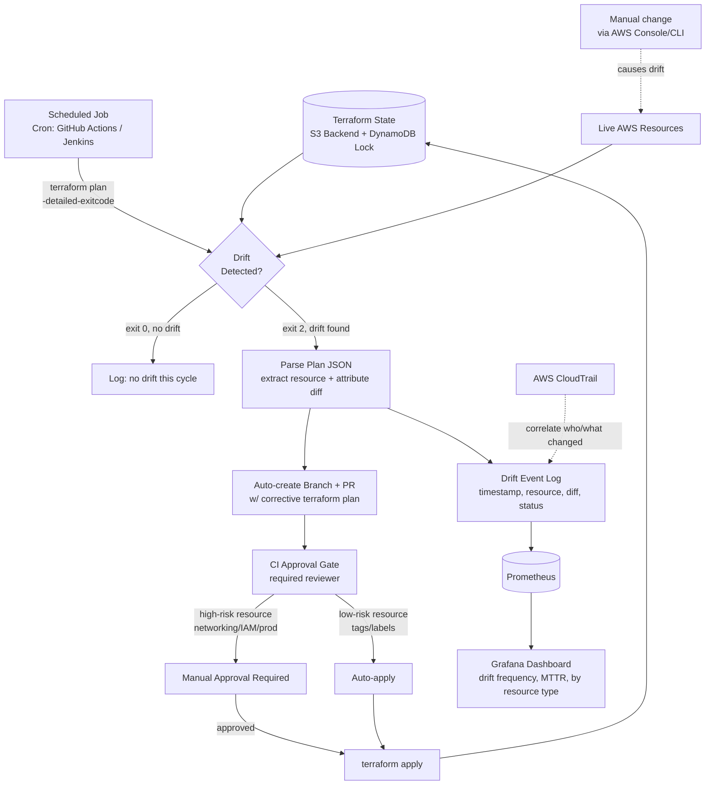

# Terraform Drift Detection & Auto-Remediation Loop — Implementation Plan (AWS)

## Problem Statement

Infrastructure-as-Code is only trustworthy if it reflects reality. In practice, someone
always eventually changes something by hand in the AWS Console — a security group rule
during an incident, a quick scale-up, a "temporary" fix — and Terraform state silently
diverges from live infra. Most teams find this out only when a future `terraform apply`
unexpectedly destroys or reverts the manual change. This project builds a continuous
control loop: scheduled drift detection, automated PR-based remediation proposals, a
human approval gate, and a trend dashboard showing how often and where drift happens.

## Architecture Diagram



## Tech Stack

| Layer | Tool |
|---|---|
| IaC | Terraform (remote backend: S3 + DynamoDB state locking) |
| Scheduling | GitHub Actions cron / Jenkins cron trigger |
| Drift parsing | `terraform plan -detailed-exitcode` + JSON plan output |
| PR automation | GitHub REST API |
| Approval gate | Branch protection + required reviewers |
| Correlation | AWS CloudTrail |
| Metrics/dashboard | Prometheus + Grafana |

## Phase-by-Phase Plan

### Phase 1 — Baseline Terraform infra
- Define initial infra as modules: VPC, EKS, security groups, IAM roles, etc.
  (reuse your AWS Landing Zone / Control Tower setup here — this project sits on top
  of it, not standalone).
- Configure a remote backend with state locking:
```hcl
terraform {
  backend "s3" {
    bucket         = "my-tfstate-bucket"
    key            = "prod/terraform.tfstate"
    region         = "us-east-1"
    dynamodb_table = "terraform-state-lock"
    encrypt        = true
  }
}
```
- Apply once to establish the known-good baseline state.

### Phase 2 — Scheduled drift-check job
- GitHub Actions example trigger:
```yaml
on:
  schedule:
    - cron: '0 */6 * * *'   # every 6 hours
```
- Job runs `terraform init` then `terraform plan -detailed-exitcode -out=plan.tfplan`.
- Exit code 0 = no drift, 1 = error, 2 = drift/changes present — branch your pipeline
  logic on this exit code.
- The AWS provider authenticates via an **IAM Role assumed through OIDC** (GitHub
  Actions OIDC → IAM Role) — no long-lived credentials stored in CI secrets.

```yaml
- name: Configure AWS credentials via OIDC
  uses: aws-actions/configure-aws-credentials@v4
  with:
    role-to-assume: arn:aws:iam::123456789012:role/GithubActionsRole
    aws-region: us-east-1
```

### Phase 3 — Parse drift output
- Convert the plan to JSON: `terraform show -json plan.tfplan > plan.json`.
- Parse `resource_changes[]` for entries where `change.actions` isn't `["no-op"]`;
  extract resource address, attribute-level before/after values.
- This structured diff is what gets attached to the PR and logged as an event —
  avoid just dumping raw plan text, it's unreadable for a reviewer under time pressure.

### Phase 4 — Auto-generate remediation PR
- On detected drift, script creates a branch (`drift-fix-<timestamp>`), commits the
  plan file/summary, and opens a PR via the GitHub REST API with the parsed diff
  formatted into the PR description as a table (resource, attribute, before, after).
- Title the PR clearly, e.g. `[Auto] Drift detected in eks-prod: 2 resources changed`.

### Phase 5 — CI approval gate
- Use branch protection rules requiring at least one approval before merge.
- Classify resources by risk: tag/label-only changes can be configured for
  auto-apply; anything touching VPC/security groups, IAM roles/policies, or
  production-tier resources requires explicit manual approval — encode this as a
  simple lookup table keyed by resource type in your pipeline logic.
- This tiered-risk design is worth calling out explicitly — it shows you understand
  why blind auto-apply is dangerous, not just that automation is good.

### Phase 6 — Log drift events centrally
- On every detection cycle, push a structured event (timestamp, resource address,
  change type, remediation status: pending/auto-applied/manually-approved) to a
  small metrics endpoint Prometheus can scrape, or to a lightweight time-series store.
- Cross-reference **AWS CloudTrail** event history around the same timestamp to
  attribute *who* or *what* made the manual change — CloudTrail records the IAM
  principal, source IP, and API call for every mutating action in the account.

### Phase 7 — Grafana drift dashboard
- Build panels for: drift events per week, breakdown by resource type, and mean
  time-to-remediate (time between detection and applied fix).
- This dashboard is what turns the project from "a script that runs `terraform plan`"
  into "a system that demonstrates operational maturity" — lead with it in a demo.

### Phase 8 — Test end-to-end and document
- Manually change a tag on a resource via the AWS Console; confirm the full loop
  fires — detection within one scheduled cycle, PR created, dashboard updated.
- Repeat with a higher-risk change (e.g. a Security Group rule) to confirm it routes
  to manual approval instead of auto-applying.
- Document why manual approval exists for high-risk resources — this is exactly the
  design-judgment question interviewers ask about automation projects.

## Validation Checklist
- [ ] Drift on a low-risk resource is detected and auto-remediated without human input
- [ ] Drift on a high-risk resource is detected and blocked pending manual approval
- [ ] PR description contains a readable, resource-level diff (not raw plan output)
- [ ] Grafana dashboard reflects a new drift event within one scheduling cycle
- [ ] No drift cycle produces zero false-positive PRs (idempotency check)

## AWS Service Mapping (Azure → AWS)

| Azure Service | AWS Equivalent |
|---|---|
| Azure Storage Backend | AWS S3 + DynamoDB (state locking) |
| Azure Portal | AWS Management Console |
| Azure Activity Log | AWS CloudTrail |
| Azure DevOps REST API | GitHub REST API |
| Azure AD (OIDC) | AWS IAM OIDC Identity Provider |

## Notes / Tradeoffs Worth Mentioning in Interviews
- Auto-apply is deliberately restricted to low-risk resource types — the point of
  this project isn't "automate everything," it's "know what's safe to automate."
- Detection frequency (every 6 hours here) is a tradeoff between responsiveness and
  AWS API/Terraform provider rate limits — worth being able to justify the interval
  you chose.
- Using IAM OIDC instead of static AWS access keys in CI is a security best practice
  worth calling out — it eliminates the risk of long-lived credential leakage.
